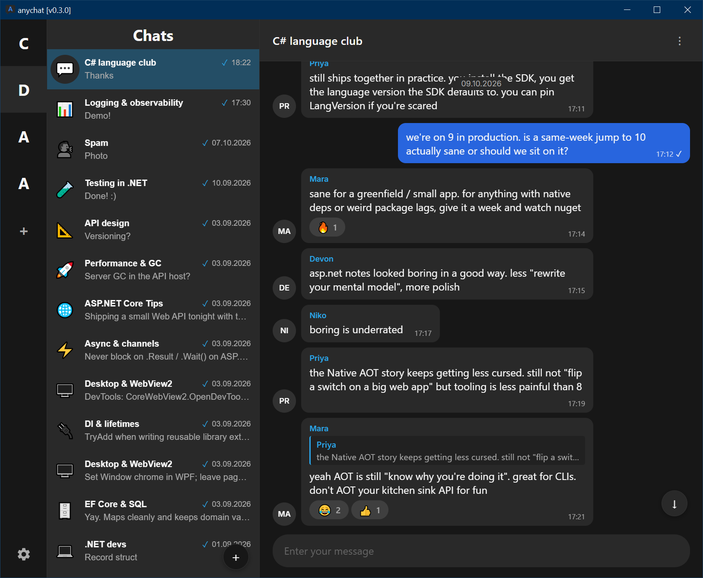

# anychat

A Windows desktop chat client for [Anytype](https://anytype.io/).

anychat is a standalone messenger for Anytype. It connects to the Anytype desktop app on your machine 
and turns your spaces and chats into a proper messenger window — send, edit, react, drafts, threads. 
And it works blazingly fast.

## Install

Requirements (Windows 10/11, x64):

- [.NET 10 Desktop Runtime](https://dotnet.microsoft.com/download/dotnet/10.0)
- [.NET 10 ASP.NET Core Runtime](https://dotnet.microsoft.com/download/dotnet/10.0)
- [WebView2 Runtime](https://developer.microsoft.com/microsoft-edge/webview2/)
- Anytype desktop app running locally

1. Download `anychat-<version>-win-x64.zip` from [Releases](https://github.com/glabular/anychat/releases).
2. Unzip and run `AnyChat.NET.Desktop.exe`.
3. On first launch, approve the pairing request in Anytype. The API key is stored encrypted (DPAPI) under `%LocalAppData%`.

## Status

Early development.

Bug reports, feature ideas, and feedback are welcome:

- [Open an issue](https://github.com/glabular/anychat/issues)
- [Join the anychat community](anytype://invite/?cid=bafybeicuqq4ubrnzrpip4jqyk3oh4h2pi6ri7i7la7dnzujabogvjftlym&key=6w947pasACkaSnNwyndGHAb5SF1UjzoKAt1cpCNLZD5F)